# Flowchart Aplikasi SIMONA

**SIMONA — Sistem Monitoring dan Nilai PKL**
SMK Negeri 6 Surakarta

Dokumen ini berisi flowchart alur kerja seluruh modul aplikasi SIMONA dalam format Mermaid.

---

## 1. Alur Utama Aplikasi

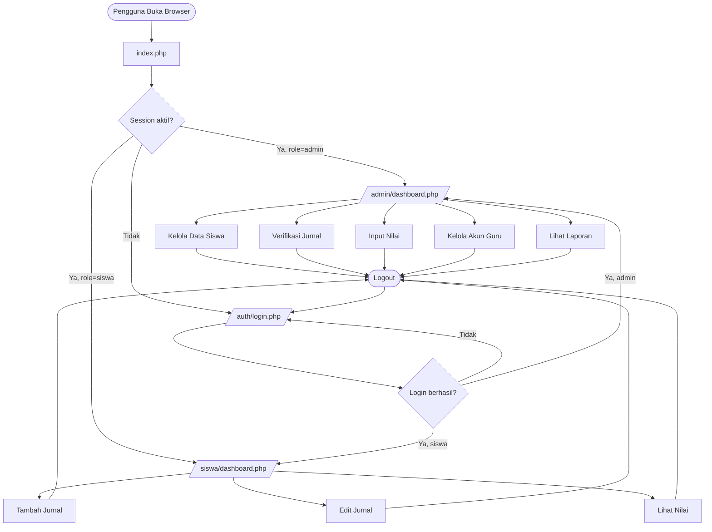

---

## 2. Alur Login Detail

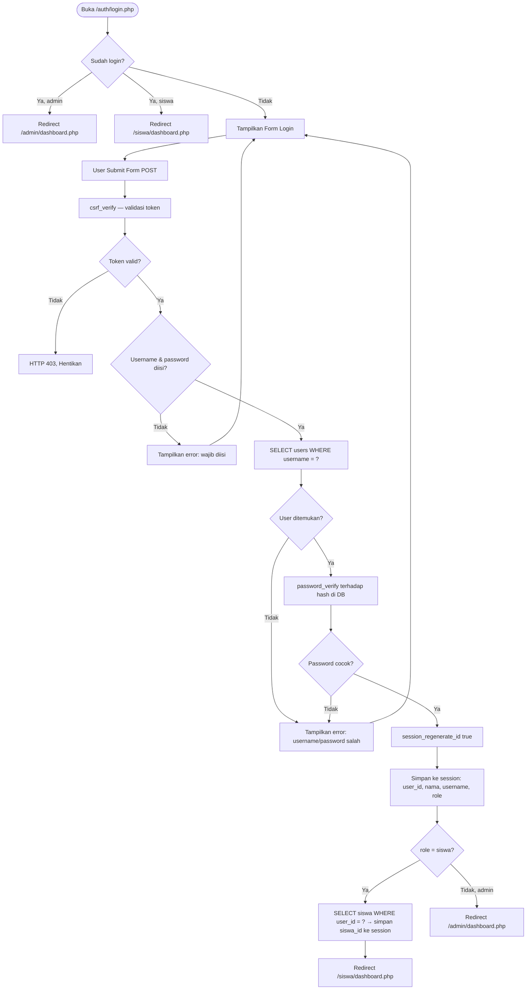

---

## 3. Alur Logout

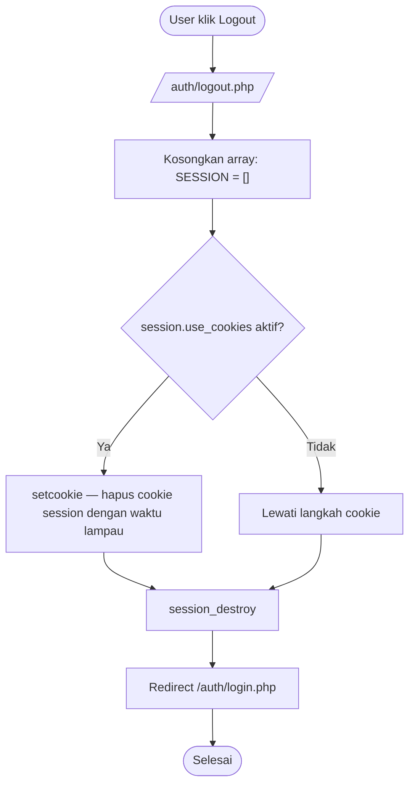

---

## 4. Alur Dashboard Admin

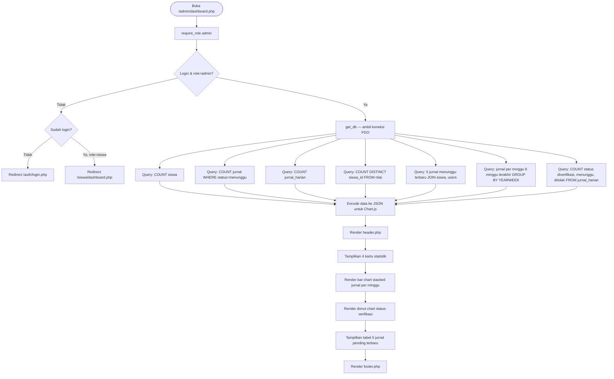

---

## 5. Alur Kelola Data Siswa

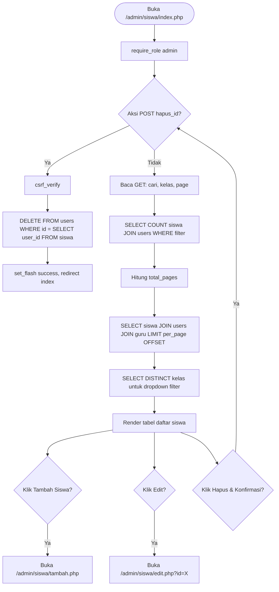

---

## 6. Alur Tambah Jurnal Siswa

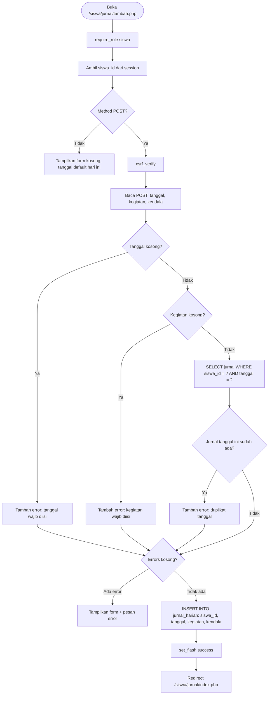

---

## 7. Alur Edit Jurnal Siswa

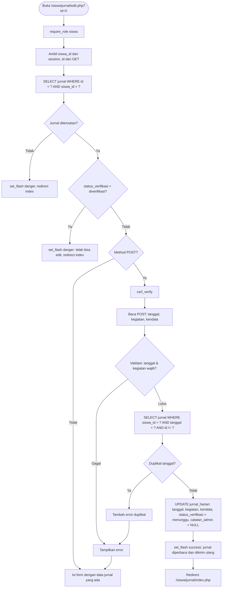

---

## 8. Alur Verifikasi Jurnal Admin

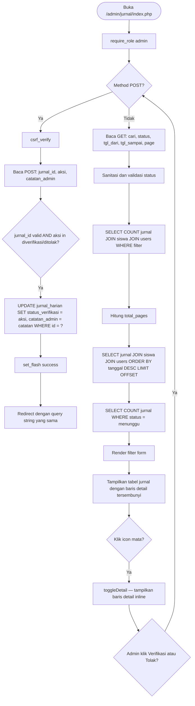

---

## 9. Alur Input Nilai Admin

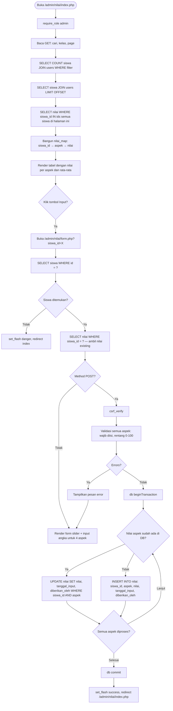

---

## 10. Alur Kelola Akun Guru

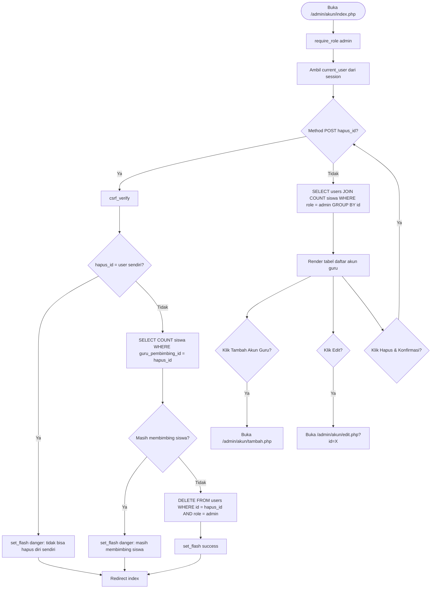

---

## 11. Alur Edit Akun Guru

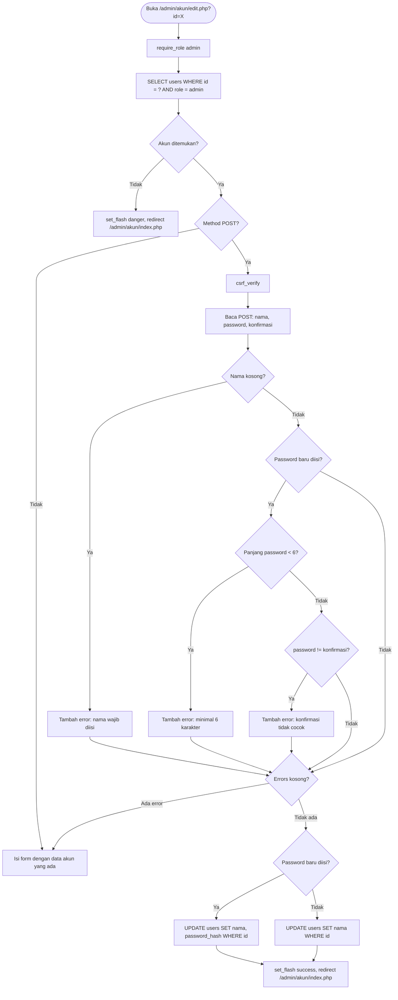

---

## 12. Alur Proteksi Halaman require_role

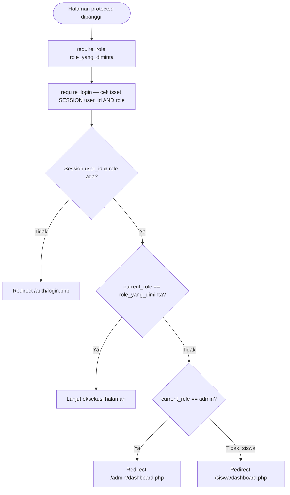
