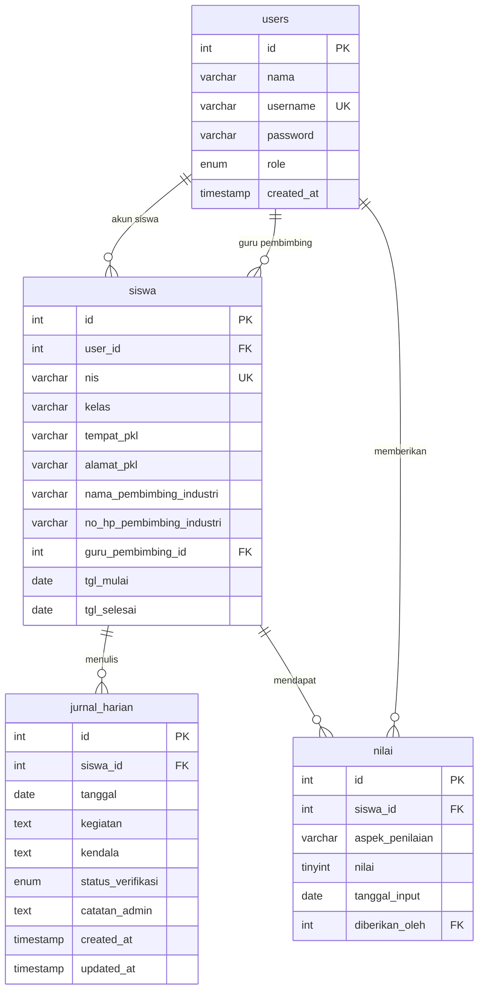

# 🌐 SIMONA — Sistem Monitoring dan Nilai PKL

\<p align="center">
&#x20; \
&#x20; \
&#x20; \
&#x20; \
\</p>

\<p align="center">
&#x20; \<b>Sistem Informasi Monitoring Praktik Kerja Lapangan Siswa SMK\</b>
&#x20; \<br>
&#x20; Platform digital untuk monitoring kegiatan, verifikasi jurnal, dan pengelolaan nilai Praktik Kerja Lapangan (PKL).
\</p>

\<p align="center">
&#x20; \<a href="[https://simona-monitoring.malaysiawest.cloudapp.azure.com/auth/login.php](https://simona-monitoring.malaysiawest.cloudapp.azure.com/auth/login.php)">
&#x20;   \<strong>🚀 KUNJUNGI WEBSITE SIMONA\</strong>
&#x20; \</a>
\</p>

---

## 📖 Tentang SIMONA

**SIMONA (Sistem Monitoring dan Nilai PKL)** merupakan aplikasi berbasis web yang dikembangkan untuk membantu proses monitoring dan penilaian kegiatan Praktik Kerja Lapangan (PKL) siswa SMK.

Aplikasi ini dirancang untuk mempermudah komunikasi dan pengelolaan aktivitas antara siswa dan guru pembimbing melalui sistem digital yang terstruktur.

Dengan SIMONA, siswa dapat mencatat kegiatan harian selama PKL, sedangkan guru pembimbing dapat memantau, memverifikasi jurnal, memberikan catatan, serta mengelola penilaian siswa.

SIMONA memiliki dua hak akses utama, yaitu:

- **Admin (Guru Pembimbing):** Mengelola data siswa, memverifikasi jurnal, memberikan nilai, dan mengelola laporan.
- **Siswa:** Mengelola jurnal harian, memantau status verifikasi, dan melihat hasil penilaian PKL.

## 🌍 Live Website

Aplikasi SIMONA telah di-deploy dan dapat diakses secara online melalui alamat berikut:

| Informasi     | Keterangan                                                                                                                    |
| ------------- | ----------------------------------------------------------------------------------------------------------------------------- |
| Nama Aplikasi | SIMONA                                                                                                                        |
| Platform      | Web Application                                                                                                               |
| Deployment    | Microsoft Azure                                                                                                               |
| URL Website   | [simona-monitoring.malaysiawest.cloudapp.azure.com](https://simona-monitoring.malaysiawest.cloudapp.azure.com/auth/login.php) |
| Halaman Login | [Buka Login SIMONA](https://simona-monitoring.malaysiawest.cloudapp.azure.com/auth/login.php)                                 |

## ✨ Fitur Aplikasi

### 👨‍🏫 1. Admin (Guru Pembimbing)

- **Dashboard Admin:** Menampilkan ringkasan statistik siswa, jurnal pending, dan informasi penilaian.
- **Manajemen Data Siswa:** Menambah, mengedit, menghapus, mencari, dan mengelola data siswa.
- **Verifikasi Jurnal:** Menyetujui atau menolak jurnal harian siswa.
- **Catatan Guru:** Memberikan catatan atau masukan terhadap jurnal siswa.
- **Manajemen Nilai:** Menginput dan mengedit nilai berdasarkan empat aspek penilaian:
  - Kedisiplinan
  - Kompetensi
  - Sikap
  - Kerja Sama
- **Laporan PKL:** Melihat rekap penilaian siswa.
- **Export CSV:** Mengunduh laporan dalam format CSV.
- **Cetak Laporan:** Mencetak hasil rekap data siswa dan penilaian.
- **Manajemen Akun:** Mengelola akun pengguna sesuai hak akses.

### 🎓 2. Siswa

- **Dashboard Siswa:** Menampilkan informasi PKL, statistik jurnal, dan nilai rata-rata.
- **Jurnal Harian:** Menambah, melihat, mengedit, dan menghapus jurnal kegiatan PKL.
- **Status Verifikasi:** Melihat status jurnal yang telah dikirim.
- **Catatan Guru:** Membaca catatan dan masukan dari guru pembimbing.
- **Informasi Nilai:** Melihat nilai berdasarkan aspek penilaian.
- **Predikat Nilai:** Menampilkan predikat A/B/C/D.
- **Proteksi Jurnal:** Jurnal yang telah diverifikasi tidak dapat diedit kembali.

## 🛠️ Teknologi yang Digunakan

| Komponen          | Teknologi       |
| ----------------- | --------------- |
| Backend           | PHP 8.x Native  |
| Database          | MySQL / MariaDB |
| Frontend          | HTML, CSS       |
| Framework CSS     | Bootstrap 5     |
| Icons             | Bootstrap Icons |
| Database Access   | PDO             |
| Local Development | XAMPP           |
| Web Server        | Apache          |
| Deployment        | Microsoft Azure |

## 🏗️ Arsitektur Aplikasi

SIMONA menggunakan arsitektur aplikasi berbasis web dengan pembagian akses berdasarkan peran pengguna.

```text
                    SIMONA
                       |
                Halaman Login
                       |
                Autentikasi User
                       |
             +---------+---------+
             |                   |
          ADMIN                SISWA
             |                   |
       Dashboard Admin     Dashboard Siswa
             |                   |
       Kelola Data Siswa   Kelola Jurnal
       Verifikasi Jurnal   Lihat Status
       Input Nilai        Lihat Nilai
       Laporan PKL             |
             |                 |
             +--------+--------+
                      |
                  Database
                    MySQL
```

## 📂 Struktur Folder

```text
Monitoring-PKL/
│
├── admin/
│   ├── akun/              # Manajemen akun guru
│   ├── jurnal/            # Verifikasi jurnal siswa
│   ├── laporan/           # Rekap dan export laporan
│   ├── nilai/             # Manajemen nilai siswa
│   ├── siswa/             # Manajemen data siswa
│   └── dashboard.php      # Dashboard admin
│
├── siswa/
│   ├── jurnal/            # Manajemen jurnal harian
│   ├── nilai/             # Informasi nilai siswa
│   └── dashboard.php      # Dashboard siswa
│
├── auth/                  # Login dan logout
├── config/                # Konfigurasi aplikasi dan database
├── database/              # File SQL database
├── includes/              # Helper, auth, CSRF, dan fungsi
│
└── index.php              # Halaman utama / redirect login
```

## 🗄️ Database dan ERD

Database SIMONA menggunakan MySQL atau MariaDB dengan beberapa tabel utama yang saling terhubung.

### Entitas Database

| Tabel           | Fungsi                                 |
| --------------- | -------------------------------------- |
| `users`         | Menyimpan data akun pengguna           |
| `siswa`         | Menyimpan informasi siswa dan data PKL |
| `jurnal_harian` | Menyimpan aktivitas harian siswa       |
| `nilai`         | Menyimpan hasil penilaian PKL          |

### Entity Relationship Diagram



## 🔐 Keamanan Sistem

SIMONA menerapkan beberapa mekanisme keamanan untuk membantu menjaga keamanan data pengguna dan aktivitas aplikasi.

- **PDO Prepared Statements:** Membantu mencegah SQL Injection.
- **Password Hashing:** Password pengguna disimpan dalam bentuk hash.
- **CSRF Token:** Memberikan perlindungan terhadap serangan Cross-Site Request Forgery.
- **Session Protection:** Mengelola autentikasi dan sesi pengguna.
- **Role-Based Access:** Membatasi akses fitur berdasarkan hak akses Admin dan Siswa.

## 🚀 Instalasi Lokal (XAMPP)

Jika ingin menjalankan SIMONA di lingkungan lokal, ikuti langkah berikut.

### 1. Clone Repository

```bash
git clone https://github.com/sandygifta-ui/Sistem-Monitoring-PKL.git Monitoring-PKL
```

Pindahkan folder proyek ke direktori:

```text
C:/xampp/htdocs/
```

### 2. Konfigurasi Database

Salin file konfigurasi database:

```bash
cp config/database.example.php config/database.php
```

Sesuaikan konfigurasi database pada `config/database.php` dengan pengaturan MySQL lokal.

### 3. Import Database

1. Jalankan Apache dan MySQL melalui XAMPP.
2. Buka `http://localhost/phpmyadmin`.
3. Pilih menu **Import**.
4. Pilih file `database/monitoring_pkl.sql`.
5. Klik **Go**.

### 4. Reset Password Akun Demo

Jalankan proses reset password satu kali jika diperlukan:

```text
http://localhost/Monitoring-PKL/database/reset_password.php
```

### 5. Jalankan Aplikasi

Buka browser dan akses:

```text
http://localhost/Monitoring-PKL
```

## ☁️ Deployment

SIMONA telah di-deploy menggunakan layanan **Microsoft Azure** sehingga aplikasi dapat diakses melalui jaringan internet.

Alamat website:

```text
https://simona-monitoring.malaysiawest.cloudapp.azure.com/auth/login.php
```

Untuk melakukan deployment ulang, sesuaikan konfigurasi aplikasi dengan lingkungan server yang digunakan, termasuk:

- Konfigurasi koneksi database.
- Versi PHP yang didukung server.
- Konfigurasi URL aplikasi.
- Pengaturan web server.
- Keamanan file konfigurasi dan kredensial.

## 🎯 Tujuan Pengembangan

SIMONA dikembangkan dengan tujuan:

1. Mempermudah monitoring kegiatan PKL siswa.
2. Membantu guru pembimbing dalam memverifikasi jurnal harian.
3. Mempermudah pengelolaan nilai PKL siswa.
4. Menyediakan laporan penilaian secara terstruktur.
5. Mendukung digitalisasi administrasi kegiatan PKL.

## 👨‍💻 Developer

**SIMONA — Sistem Monitoring dan Nilai PKL**

Dikembangkan sebagai proyek Uji Kompetensi Keahlian (UKK) siswa SMK.

\<p align="center">   \<b>Built with ❤️ using PHP, MySQL, and Bootstrap 5\</b>   \<br>\<br>   \<a href="[https://simona-monitoring.malaysiawest.cloudapp.azure.com/auth/login.php](https://simona-monitoring.malaysiawest.cloudapp.azure.com/auth/login.php)">     🌐 Visit SIMONA Website   \</a>   \<br>\<br>   \<sub>© 2026 SIMONA. All Rights Reserved.\</sub> \</p>
