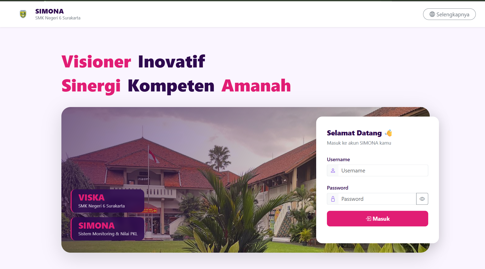
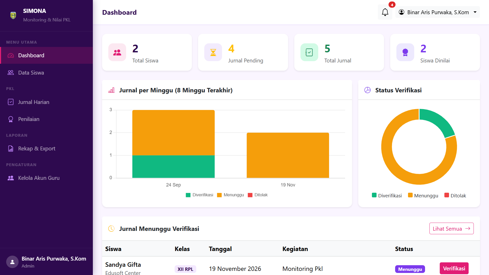
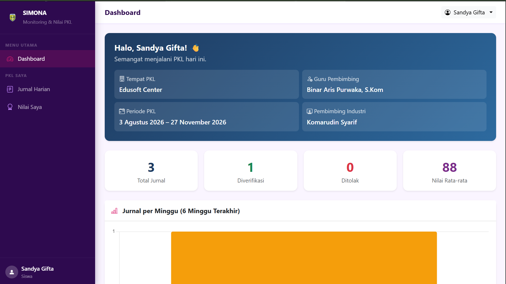
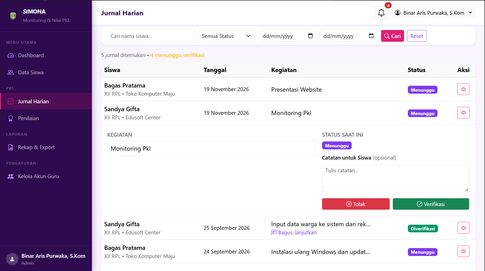
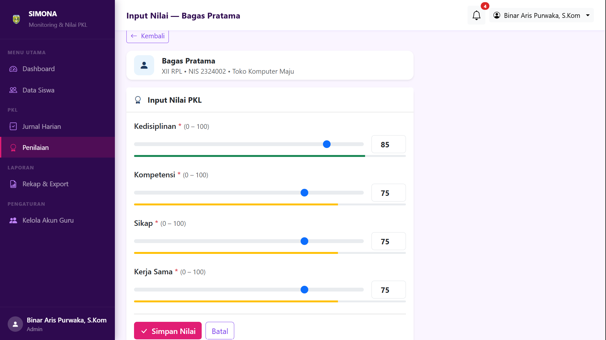
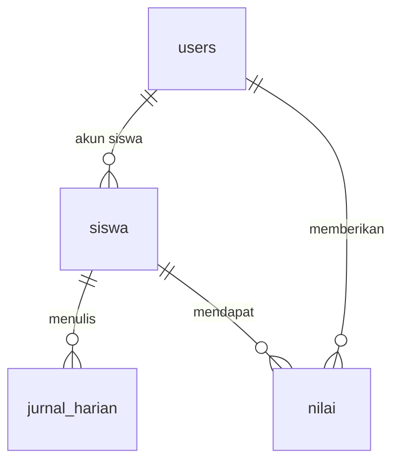

# 🌐 SIMONA — Sistem Monitoring dan Nilai PKL

<p align="center">
  
  
  
  
</p>

<p align="center">
  <b>Sistem Informasi Monitoring Praktik Kerja Lapangan Siswa SMK</b>
  <br>
  Platform digital untuk monitoring kegiatan, verifikasi jurnal, dan pengelolaan nilai PKL.
</p>

<p align="center">
  <a href="https://simona-monitoring.malaysiawest.cloudapp.azure.com/auth/login.php">
    <strong>🚀 KUNJUNGI WEBSITE SIMONA</strong>
  </a>
</p>

---

## 📖 Tentang SIMONA

**SIMONA (Sistem Monitoring dan Nilai PKL)** merupakan aplikasi berbasis web yang dikembangkan untuk membantu proses monitoring dan penilaian kegiatan Praktik Kerja Lapangan (PKL) siswa SMK.

Aplikasi ini mempermudah komunikasi dan pengelolaan aktivitas antara siswa dan guru pembimbing melalui sistem digital yang terstruktur.

SIMONA memiliki dua hak akses utama:

- **Admin (Guru Pembimbing):** Mengelola data siswa, memverifikasi jurnal, memberikan nilai, dan mengelola laporan.
- **Siswa:** Mengelola jurnal harian, memantau status verifikasi, dan melihat hasil penilaian PKL.

## ✨ Fitur Aplikasi

### 👨‍🏫 Admin (Guru Pembimbing)

- Dashboard statistik siswa dan jurnal.
- Manajemen data siswa.
- Verifikasi jurnal harian.
- Memberikan catatan atau masukan pada jurnal.
- Input dan edit nilai siswa.
- Rekap laporan PKL.
- Export laporan dalam format CSV.
- Cetak laporan.
- Manajemen akun pengguna.

### 🎓 Siswa

- Dashboard informasi PKL.
- Menambah, melihat, mengedit, dan menghapus jurnal harian.
- Melihat status verifikasi jurnal.
- Membaca catatan guru pembimbing.
- Melihat hasil penilaian PKL.
- Melihat predikat nilai A/B/C/D.

---

## 📸 Tampilan Aplikasi

Berikut beberapa tampilan antarmuka SIMONA.

> Simpan screenshot aplikasi di folder `assets/screenshots/`, kemudian sesuaikan nama file gambar dengan file yang kamu miliki.

### 1. Halaman Login

Halaman awal untuk pengguna masuk ke aplikasi menggunakan akun masing-masing.



### 2. Dashboard Admin

Menampilkan ringkasan informasi dan menu pengelolaan PKL untuk guru pembimbing.



### 3. Dashboard Siswa

Menampilkan informasi PKL, jurnal kegiatan, dan nilai siswa.



### 4. Monitoring dan Verifikasi Jurnal

Halaman untuk melihat, memeriksa, serta memverifikasi jurnal kegiatan siswa.



### 5. Pengelolaan Nilai PKL

Halaman untuk memasukkan, mengubah, dan melihat hasil penilaian siswa.



---

## 🛠️ Teknologi yang Digunakan

| Komponen | Teknologi |
|---|---|
| Backend | PHP 8.x Native |
| Database | MySQL / MariaDB |
| Frontend | HTML, CSS |
| Framework CSS | Bootstrap 5 |
| Icons | Bootstrap Icons |
| Database Access | PDO |
| Local Development | XAMPP |
| Web Server | Apache |
| Deployment | Microsoft Azure |

---

## 📂 Struktur Folder

```text
Monitoring-PKL/
│
├── admin/
│   ├── akun/
│   ├── jurnal/
│   ├── laporan/
│   ├── nilai/
│   ├── siswa/
│   └── dashboard.php
│
├── siswa/
│   ├── jurnal/
│   ├── nilai/
│   └── dashboard.php
│
├── auth/
├── config/
├── database/
├── includes/
│
└── index.php
```

---

## 🚀 Panduan Instalasi

Ikuti langkah-langkah berikut untuk menjalankan SIMONA di komputer lokal menggunakan XAMPP.

### 1. Persiapan

Pastikan perangkat sudah memiliki:

- XAMPP.
- Git.
- Browser.
- Code editor, seperti Visual Studio Code.

### 2. Clone Repository

Buka terminal atau Command Prompt, kemudian jalankan:

```bash
git clone https://github.com/sandygifta-ui/Sistem-Monitoring-PKL.git Monitoring-PKL
```

### 3. Pindahkan Folder Project

Pastikan folder `Monitoring-PKL` berada di:

```text
C:/xampp/htdocs/
```

### 4. Konfigurasi Database

Buka folder project melalui Visual Studio Code.

Salin file:

```text
config/database.example.php
```

Kemudian ubah nama salinannya menjadi:

```text
config/database.php
```

Sesuaikan konfigurasi koneksi database dengan pengaturan MySQL lokal.

### 5. Import Database

1. Buka XAMPP Control Panel.
2. Jalankan Apache dan MySQL.
3. Buka browser dan akses `http://localhost/phpmyadmin`.
4. Pilih menu **Import**.
5. Pilih file `database/monitoring_pkl.sql`.
6. Klik **Go** untuk memulai proses import.

### 6. Jalankan Aplikasi

Buka browser dan akses:

```text
http://localhost/Monitoring-PKL
```

Aplikasi SIMONA siap digunakan setelah konfigurasi database berhasil.

---

## 📚 Panduan Penggunaan

### A. Admin (Guru Pembimbing)

**1. Login**

- Buka halaman login SIMONA.
- Masukkan username dan password Admin.
- Klik tombol Login.

**2. Dashboard Admin**

Setelah berhasil login, Admin akan diarahkan ke dashboard yang menampilkan ringkasan informasi siswa, jurnal, dan penilaian.

**3. Mengelola Data Siswa**

- Buka menu Data Siswa.
- Tambahkan data siswa baru jika diperlukan.
- Edit atau hapus data siswa melalui menu yang tersedia.

**4. Monitoring dan Verifikasi Jurnal**

- Buka menu Jurnal.
- Pilih jurnal siswa yang ingin diperiksa.
- Periksa kegiatan yang telah dikirim.
- Berikan catatan jika diperlukan.
- Setujui atau tolak jurnal sesuai hasil pemeriksaan.

**5. Mengelola Nilai PKL**

- Buka menu Nilai.
- Pilih siswa yang akan diberikan penilaian.
- Masukkan nilai berdasarkan aspek penilaian:
  - Kedisiplinan
  - Kompetensi
  - Sikap
  - Kerja Sama
- Simpan nilai.

**6. Mengelola Laporan**

- Buka menu Laporan.
- Lihat rekap penilaian siswa.
- Gunakan fitur Export CSV atau Cetak Laporan jika diperlukan.

### B. Siswa

**1. Login**

- Buka halaman login SIMONA.
- Masukkan username dan password siswa.
- Klik tombol Login.

**2. Dashboard Siswa**

Setelah berhasil login, siswa akan diarahkan ke dashboard yang menampilkan informasi PKL, statistik jurnal, dan nilai rata-rata.

**3. Mengelola Jurnal Harian**

- Buka menu Jurnal.
- Tambahkan jurnal kegiatan PKL.
- Isi tanggal, kegiatan, dan kendala.
- Simpan jurnal yang telah dibuat.

**4. Memantau Status Verifikasi**

- Buka daftar jurnal.
- Periksa status verifikasi jurnal.
- Baca catatan atau masukan dari guru pembimbing jika tersedia.

**5. Melihat Nilai PKL**

- Buka menu Nilai.
- Lihat hasil penilaian berdasarkan aspek yang diberikan guru pembimbing.
- Periksa predikat nilai yang ditampilkan.

**6. Logout**

Klik tombol Logout untuk keluar dari akun SIMONA.

---

## 🗄️ Database dan ERD

SIMONA menggunakan MySQL atau MariaDB dengan beberapa tabel utama:

| Tabel | Fungsi |
|---|---|
| `users` | Menyimpan data akun pengguna |
| `siswa` | Menyimpan informasi siswa dan data PKL |
| `jurnal_harian` | Menyimpan aktivitas harian siswa |
| `nilai` | Menyimpan hasil penilaian PKL |

### Entity Relationship Diagram



---

## 🔐 Keamanan Sistem

SIMONA menerapkan beberapa mekanisme keamanan:

- **PDO Prepared Statements:** Membantu mencegah SQL Injection.
- **Password Hashing:** Menyimpan password dalam bentuk hash.
- **CSRF Token:** Memberikan perlindungan terhadap Cross-Site Request Forgery.
- **Session Protection:** Mengelola autentikasi dan sesi pengguna.
- **Role-Based Access:** Membatasi akses fitur berdasarkan hak akses Admin dan Siswa.

---

## ☁️ Deployment

SIMONA telah di-deploy menggunakan layanan **Microsoft Azure** sehingga dapat diakses melalui internet.

**Website SIMONA:**

https://simona-monitoring.malaysiawest.cloudapp.azure.com/auth/login.php

---

## 🎯 Tujuan Pengembangan

1. Mempermudah monitoring kegiatan PKL siswa.
2. Membantu guru pembimbing memverifikasi jurnal harian.
3. Mempermudah pengelolaan nilai PKL siswa.
4. Menyediakan laporan penilaian secara terstruktur.
5. Mendukung digitalisasi administrasi kegiatan PKL.

---

## 👨‍💻 Developer

**SIMONA — Sistem Monitoring dan Nilai PKL**

Dikembangkan sebagai proyek Uji Kompetensi Keahlian (UKK) siswa SMK.

<p align="center">
  <b>Built with ❤️ using PHP, MySQL, and Bootstrap 5</b>
  <br><br>
  <a href="https://simona-monitoring.malaysiawest.cloudapp.azure.com/auth/login.php">
    🌐 Visit SIMONA Website
  </a>
  <br><br>
  <sub>© 2026 SIMONA. All Rights Reserved.</sub>
</p>
